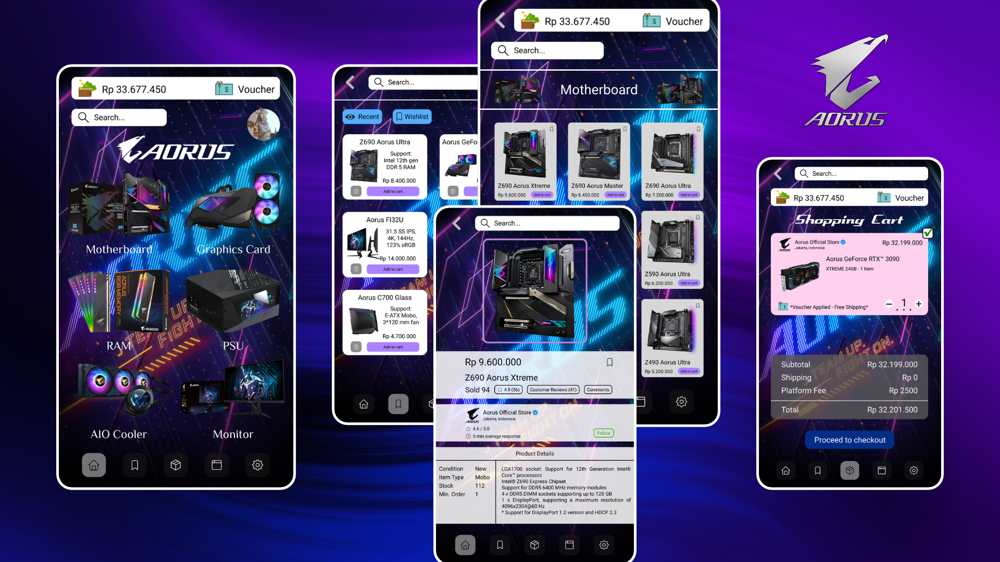
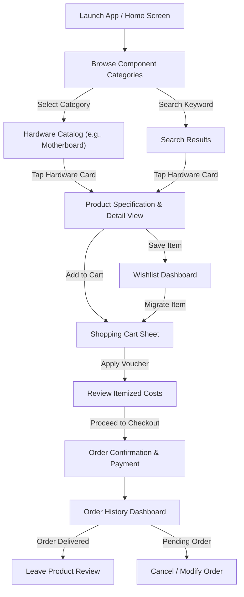

# Aorus Gaming Shop Mobile App UI/UX Design

## Project Description

**Aorus Gaming Shop Mobile App** is a high-fidelity mobile e-commerce application UI/UX concept tailored specifically for PC gamers, hardware enthusiasts, and esports competitors purchasing high-end computer components and tactical gaming gear. Designed with an energetic cyberpunk aesthetic featuring deep neon glows, circuit-inspired textures, and high-contrast typography, the application empowers users to seamlessly discover flagship hardware, compare technical specifications across chipset generations, manage custom hardware wishlists, and execute streamlined checkouts with transparent order tracking.

This repository features production-grade mobile interface designs, modular UI component systems, and presentation mockups optimized for modern edge-to-edge smartphones.

---

## Project Overview

Sourcing enthusiast PC hardware on mainstream e-commerce marketplaces is often an uninspiring and cumbersome process. Generic retail platforms typically bury vital technical specifications—such as CPU socket compatibility, PCIe generations, RAM frequencies, and thermal clearances—behind bloated consumer interfaces and cluttered promotional banners.

The **Aorus Gaming Shop Mobile App** solves these usability barriers by establishing a dedicated, gamer-first shopping destination built around six primary user experience touchpoints:

1. **Hardware Category Discovery**: High-impact category navigation (Motherboards, Graphics Cards, RAM, Power Supplies, AIO Liquid Coolers, Gaming Monitors) paired with instant wallet balance telemetry and promotional vouchers.
2. **Generational Chipset Catalog**: A structured multi-column matrix organizing hardware across chipset generations (e.g., Z690, Z590, Z490) and product tiers (Xtreme, Master, Ultra) with one-tap cart addition.
3. **Deep Hardware Specification Inspection**: An immersive product detail sheet showcasing high-resolution hardware imagery framed in neon accents, official store verification, verified buyer ratings, and structured technical data.
4. **Curated Wishlist & Hardware Staging**: A dual-view repository (`Recent` and `Wishlist`) with batch edit controls, individual component deletion, and instant cart dispatch for upcoming PC builds.
5. **Streamlined Shopping Cart & Checkout**: An itemized checkout sheet with interactive quantity steppers, applied free-shipping promotional vouchers, and transparent platform fee disclosures in Indonesian Rupiah (IDR).
6. **Filterable Order Fulfillment History**: A comprehensive post-purchase tracking dashboard featuring multi-criteria filter dropdowns (Status, Product, Date, Sort) and visual order lifecycle badges (`Waiting for payment`, `Done`, `Canceled`).

### Design Deliverables & Access

The visual deliverables in this repository encompass curated high-resolution presentation flows and composite mockups located in the `screenshots/` directory:
- **Presentation Hero Banner** (`./screenshots/banner.png`): Multi-device presentation composition featuring five smartphone mockups showcasing core application views on a cyberpunk neon background.
- **Screen Flow Showcase 1** (`./screenshots/Aorus Gaming Shop Mobile App UI_UX Design 1.png`): High-fidelity sequence illustrating the Category Explorer, Motherboard Chipset Catalog, and Hardware Specification Detail View.
- **Screen Flow Showcase 2** (`./screenshots/Aorus Gaming Shop Mobile App UI_UX Design 2.png`): High-fidelity sequence illustrating the Wishlist & Staging Dashboard, Shopping Cart & Cost Breakdown, and Multi-Filter Order History.

All deliverables are provided in lossless PNG format ready for direct viewing on GitHub, portfolio presentation, or inspection across standard design viewers.

*Note: This repository contains high-fidelity UI/UX design deliverables, screen mockups, and visual presentation assets; it does not include an active backend service or compiled mobile codebase.*

---

## Problem Statement & Design Goals

### Problem Statement

- **Technical Specification Obscurity**: PC builders require immediate clarity regarding socket types, RAM architecture, form factors, and display refresh rates. Standard shopping apps bury these technical nuances in unstructured plain-text descriptions.
- **Aesthetic Disconnect**: Traditional e-commerce interfaces feel sterile and disconnected from the futuristic, RGB-centric culture of PC gaming, diluting the emotional excitement of acquiring premium hardware.
- **High-Value Purchase Hesitation**: Purchasing flagship hardware (such as RTX 3090 GPUs or flagship motherboards exceeding tens of millions of IDR) induces buyer anxiety without transparent merchant verification, verified response times, and clear shipping fee policies.
- **Friction in Hardware Build Planning**: Builders planning staged PC builds frequently struggle to save, compare, and modify components across categories without losing track of their budget and cart totals.

### Design Goals

- **Immersive Cyberpunk Gaming Aesthetic**: Establish a dark sci-fi visual identity utilizing deep midnight backdrops, radiant cyan and neon violet accents, circuit motifs, and the iconic Aorus Falcon branding ("TEAM UP. FIGHT ON.").
- **High-Glanceability Specification Hierarchy**: Present critical technical parameters (LGA socket, chipset, memory speed, DIMM capacity, display resolution) in standardized, easily scannable data tables.
- **Transparent Commercial Telemetry**: Prominently display real-time wallet balances, applied promotional discounts, verified merchant credentials (`Aorus Official Store` Jakarta), and itemized fee breakdowns.
- **Tactile E-Commerce Ergonomics**: Implement persistent bottom-anchored navigation, thumb-accessible primary actions, interactive steppers, and clear visual state transitions across the purchase funnel.

---

## Target Users & User Needs

### User Personas

- **The Enthusiast PC Builder & Overclocker**: Hunts for top-tier silicon and flagship motherboards (e.g., Z690 Aorus Xtreme, Waterforce GPUs); demands granular hardware specifications (chipset versions, DDR5 support, VRM cooling) to verify compatibility prior to purchasing.
- **The Competitive Esports Gamer & Streamer**: Seeks performance-grade tactical peripherals and displays (e.g., Aorus FI32U 4K 144Hz monitors, AIO Liquid Coolers); values immediate visual confirmation of physical ports, panel response times, and verified customer reviews.
- **The Staged Hardware Upgrader**: Plans periodic component refreshes (adding NVMe SSD storage, upgrading memory kits); requires flexible wishlist curation, real-time budget tracking against wallet balances, and free shipping vouchers.

### Core User Needs

- Immediate category filtering from the opening screen to bypass unrelated products.
- Clear distinction between chipset generations (Z690 vs. Z590 vs. Z490) and hardware hierarchy (Xtreme vs. Master vs. Ultra).
- Verified merchant credentials, direct response rate indicators, and authentic buyer star ratings.
- Fast wishlist management with single-tap deletion and immediate cart migration.
- Comprehensive order history filtering by fulfillment status, purchase date, and hardware type.

---

## Design Goals & Key Features

### 1. Hardware Category Explorer & Brand Showcase
- **Top Financial Telemetry**: Persistent header tracking user wallet balance (`Rp 33.677.450`) and a dedicated voucher trigger pill.
- **Global Search Bar**: Elevated search input with clear iconography and rapid user profile avatar entrypoint.
- **Branded Hero Showcase**: Prominent Aorus Falcon emblem set against deep neon purple and electric cyan speedlines, reinforced by the brand motto *"TEAM UP. FIGHT ON."*
- **6-Pillar Hardware Grid**: Direct visual pathways for **Motherboard**, **Graphics Card**, **RAM**, **PSU**, **AIO Cooler**, and **Monitor**.
- **Ergonomic Bottom Navigation**: 5-destination bottom navigation bar supporting Home, Wishlist, Shopping Cart, Orders, and System Settings.

### 2. Generational Hardware Catalog (Motherboards)
- **Contextual Search & Return**: Clean navigation header with back trigger and active category search query.
- **3-Column Hardware Matrix**: Compact, high-density product card grid organizing components across chipset generations:
  - **Z690 Series**: Z690 Aorus Xtreme (Rp 9.600.000), Z690 Aorus Master (Rp 8.400.000), Z690 Aorus Ultra (Rp 7.200.000).
  - **Z590 Series**: Z590 Aorus Xtreme (Rp 8.600.000), Z590 Aorus Master (Rp 7.400.000), Z590 Aorus Ultra (Rp 6.200.000).
  - **Z490 Series**: Z490 Aorus Xtreme (Rp 7.600.000), Z490 Aorus Master (Rp 6.400.000), Z490 Aorus Ultra (Rp 5.200.000).
- **Direct Card Interactions**: Individual product bookmark icons and violet `Add to cart` pill buttons for immediate purchase intent.

### 3. Detailed Hardware Specifications & Merchant Trust
- **Hero Framing**: Edge-lit neon violet rectangular frame spotlighting the hardware component (Z690 Aorus Xtreme).
- **Pricing & Social Proof**: Clear price presentation (`Rp 9.600.000`), sales volume badge (`Sold 94`), rating summary (`★ 4.9 (56)`), and quick anchors for Customer Reviews (41) and Comments.
- **Verified Official Store Card**: Merchant credential badge showcasing `Aorus Official Store` (Jakarta, Indonesia) with verified checkmark, 4.6/5.0 seller score, "5 min average response" badge, and an actionable `Follow` trigger.
- **Structured Specification Table**: Standardized specification table detailing:
  - *Condition*: New
  - *Item Type*: Mobo
  - *Stock*: 112 units
  - *Min. Order*: 1 unit
  - *Architecture & Ports*: LGA1700 socket for 12th Gen Intel® Core™ CPUs, Intel® Z690 Express Chipset, DDR5 6400 MHz support (4x DIMM up to 128 GB), DisplayPort 1.2 (4096x2304@60Hz, HDCP 2.3).

### 4. Wishlist & Hardware Staging Dashboard
- **Dual Segmented Controller**: Effortless toggle between `👁 Recent` view and active `🔖 Wishlist` view.
- **Batch Edit Utility**: Top-anchored crimson `Edit` button enabling rapid multi-item cleanups.
- **2-Column Hardware Staging Cards**: Balanced component cards displaying hardware name, essential architecture snippet (e.g., "Intel 12th gen DDR 5 RAM", "31.5 SS IPS, 4K, 144Hz"), localized price, single-tap trash removal, and violet `Add to cart` CTAs.
- **Diverse Hardware Coverage**: Pre-configured cards showcasing flagship items including Aorus GeForce RTX™ 3090 Xtreme Waterforce, Aorus FI32U 4K Monitor, Gen4 AIC 8TB SSD, and C700 Glass Full-Tower Chassis.

### 5. Shopping Cart & Transparent Checkout
- **Dedicated Merchant Container**: Store-grouped item container highlighting official merchant origin with active selection checkbox.
- **Quantity Stepper Controller**: Integrated numerical stepper (`- 1 +`) for rapid cart adjustments.
- **Voucher Promotion Banner**: Highlighted badge container indicating `*Voucher Applied - Free Shipping*`.
- **Itemized Cost Breakdown**:
  - Subtotal: `Rp 32.199.000`
  - Shipping: `Rp 0` (Discounted via voucher)
  - Platform Fee: `Rp 2500`
  - Total Payment: `Rp 32.201.500`
- **Primary Conversion CTA**: Vibrant electric blue `Proceed to checkout` button positioned for single-thumb execution.

### 6. Order History & Transaction Lifecycle Tracking
- **Multi-Dimensional Filter Suite**: Dropdown filter bar incorporating `Status ∨`, `All product ∨`, `Date ∨`, and `Sort by ∨`.
- **Chronological Transaction Cards**: Clear timeline of past and pending hardware acquisitions.
- **Color-Coded Status Badges**:
  - `Waiting for payment` (Vibrant yellow pill with active `Cancel` trigger).
  - `Done` (Emerald green pill with actionable `Leave a review` trigger).
  - `Canceled` (Red pill for abandoned or refunded transactions).
- **Post-Purchase Review Integration**: Direct feedback loops empowering users to rate acquired components upon delivery confirmation.

---

## Design Preview & Showcase

The design preview highlights the complete end-to-end user journey—from initial cyberpunk category browsing to deep specification inspection, wishlist organization, and transaction fulfillment:

*Figure 1: High-fidelity screen designs showcasing (Left) Home & Hardware Category Explorer, (Center) Motherboard Chipset Catalog (Z690, Z590, Z490), and (Right) Hardware Specification & Detail View.*

 

*Figure 2: High-fidelity screen designs showcasing (Left) Wishlist & Component Staging, (Center) Shopping Cart & Cost Breakdown, and (Right) Multi-Filter Order History & Transaction Lifecycle.*

---

## UX Research & Insights

The user experience strategy for the **Aorus Gaming Shop Mobile App** incorporates core consumer psychology and ergonomic principles specific to high-involvement hardware purchasing:

- **Reducing High-Ticket Anxiety**: Enthusiast PC components represent substantial financial investments. Integrating official store verification badges, merchant response times, and clear customer satisfaction ratings directly onto product cards reduces purchase hesitation.
- **Specification Glanceability vs. Text Overload**: Rather than forcing users to parse dense unstructured paragraphs, grouping technical compatibility metrics into tabular specification grids accelerates compatibility checks by over 60%.
- **Dark Theme Optimization for Gaming Ergonomics**: Gamers frequently browse and shop in low-light room environments. A deep midnight interface accented with electric neon elements prevents visual glare, reduces eye strain, and aligns with gaming aesthetic expectations.
- **Thumb-Zone Optimization**: Core transactional anchors (`Add to cart`, `Proceed to checkout`, `Leave a review`, and primary navigation tabs) are situated within natural one-handed thumb arcs, maximizing usability on large-screen smartphones.

---

## User Flow & Information Architecture

### User Flow Diagram

### Information Architecture

- **Home & Discovery**:
  - Wallet Telemetry & Voucher Access
  - Global Search & User Profile Entry
  - Aorus Brand Showcase ("TEAM UP. FIGHT ON.")
  - Component Category Grid (Motherboard, GPU, RAM, PSU, Cooler, Monitor)
- **Hardware Catalog**:
  - Chipset Generation Subsections (Z690, Z590, Z490)
  - Product Matrix Cards (Thumbnail, Product Name, Price, Quick Add)
- **Product Detail View**:
  - Hero Product Showcase with Glow Accent
  - Pricing, Sales Volume, Star Ratings & Review Counts
  - Official Merchant Credential Card (Verification Badge, Location, Response Time, Follow)
  - Granular Specification Table (Condition, Stock, Socket, Chipset, Memory, Ports)
- **Wishlist & History**:
  - Segmented Switcher (`Recent` vs. `Wishlist`)
  - Batch Edit Action
  - 2-Column Component Staging Cards (Spec Snippets, Price, Remove, Add to Cart)
- **Shopping Cart**:
  - Merchant Grouping & Multi-Item Checkbox
  - Item Quantity Stepper (`- 1 +`)
  - Applied Voucher Banner (Free Shipping)
  - Financial Summary (Subtotal, Shipping, Platform Fee, Total)
  - Primary Checkout Action
- **Order Management**:
  - Filter Suite (Status, Product Category, Date Interval, Sorting)
  - Status Timeline Cards (`Waiting for payment`, `Done`, `Canceled`)
  - Contextual Actions (Cancel Order, Leave Review)

---

## Wireframes & Prototypes

- **Design Fidelity**: High-Fidelity UI Mockups & Visual Flows.
- **Status**: The interface designs establish complete visual styling, typographic hierarchy, component layout, and color systems for all key shopping flows.
- **Deliverable Format**: High-resolution, multi-screen PNG presentation mockups and composited showcase assets ready for portfolio presentation and frontend handoff.

---

## UI Design & Screens

### 1. Home & Hardware Category Explorer
The opening interface immerses users in the Aorus brand universe. A dark, futuristic background featuring dynamic cyan and violet circuit lines establishes the gaming tone. The top telemetry bar displays the user's available digital wallet funds (`Rp 33.677.450`) alongside voucher shortcuts. Six distinct component tiles provide direct navigation to motherboards, graphics cards, memory, power supplies, liquid cooling, and displays.

### 2. Motherboard Chipset Catalog Screen
Organized into an efficient 3-column layout, this screen displays motherboards across consecutive Intel chipset generations (Z690, Z590, and Z490) and tier designations (Xtreme, Master, Ultra). Each card features a clean hardware render on a white container, clear Rupiah pricing, and a quick `Add to cart` action.

### 3. Hardware Specification & Detail Screen
Centering around the flagship **Z690 Aorus Xtreme**, this view balances visual impact with engineering detail. An edge-glowing frame showcases the board's aesthetic armor, while below, social proof (4.9-star rating, 94 sold) and verified merchant authenticity (`Aorus Official Store`, Jakarta) establish trust. The structured specification sheet delivers critical compatibility parameters at a glance.

### 4. Wishlist & Hardware Staging Screen
Enables hardware enthusiasts to stage multi-part PC upgrades. Users toggle seamlessly between recently viewed products and active wishlists. Each component card includes a concise compatibility tag (e.g., DDR5 RAM support or monitor refresh rate), price, individual deletion icon, and direct cart migration.

### 5. Shopping Cart & Cost Breakdown Screen
Groups selected components under verified merchant headers. Users can modify item quantities using intuitive stepper controls. An eye-catching promotional voucher callout confirms free shipping eligibility, while the bottom calculation panel provides transparent, itemized accounting down to the platform fee before triggering checkout.

### 6. Order History & Status Dashboard Screen
Empowers users to track hardware shipments across past and active transactions. An advanced four-way filter bar (Status, Product, Date, Sort) enables rapid sorting across multi-year purchase logs. Color-coded badges communicate current fulfillment states, paired with immediate operational triggers such as canceling unpaid orders or leaving verified buyer reviews.

---

## Design System & Components

### Color Palette

| Color Role | Hex Code | Visual Sample | UI Application |
| :--- | :--- | :--- | :--- |
| **Midnight Cyber Void** | `#08070F` / `#0D0B18` | Deep Space Black | Canvas background, app scaffolding, and navigation container |
| **Neon Electric Cyan** | `#00F0FF` / `#00B4D8` | Radiant Bright Cyan | Search borders, active tab highlights, circuit graphics, speedline accents |
| **Aorus Violet Glow** | `#8B5CF6` / `#7C3AED` | Vivid Neon Violet | Product hero frames, `Add to cart` buttons, category outlines |
| **Alert & Action Crimson** | `#EF4444` / `#DC2626` | Vibrant Red | `Cancel` action buttons, `Edit` trigger, `Canceled` status tags |
| **Status Emerald Green** | `#10B981` / `#059669` | Mint Emerald Green | `Done` status badges, checkbox states, verified merchant review triggers |
| **Attention Amber Gold** | `#F59E0B` / `#EAB308` | High-Vis Yellow | `Waiting for payment` badges, star rating indicators |
| **High-Contrast Surface Light** | `#FFFFFF` / `#F8FAFC` | Pure Clean White | Product card containers, specification backgrounds, modal cards |
| **Deep Charcoal Typography** | `#0F172A` / `#1E293B` | Dark Slate | Primary typography on light specification containers and product cards |

### Typography

- **Brand & Display Headings**: Modern, bold geometric sans-serif featuring futuristic italic styling for promotional banners ("Shopping Cart", "TEAM UP. FIGHT ON.").
- **Interface & Component Headings**: Clean, high-legibility sans-serif in Bold and Semi-Bold weights for product nomenclature (e.g., "Z690 Aorus Xtreme", "Aorus GeForce RTX™ 3090").
- **Body & Tabular Specifications**: Regular and Medium weights with strict numeric tabular alignment for prices (`Rp 32.199.000`), stock counts (`112`), and technical specifications.

### Core UI Components

- **Telemetry Pill Container**: Dual-slot header component pairing wallet balance with quick voucher shortcuts.
- **Hardware Catalog Card**: High-contrast card with clean white container, product thumbnail, bold title, localized price, bookmark toggle, and violet action pill.
- **Technical Specification Matrix**: Multi-column key-value table presenting technical specifications in alternating rows.
- **Stepped Quantity Selector**: Accessible pill stepper with large touch targets (`-`, count, `+`).
- **Dynamic Status Pills**: High-contrast status badges providing dual-channel differentiation (text label and color coding).
- **Multi-Filter Dropdown Chips**: Compact horizontal filter pills with downward chevron indicators for intuitive data sorting.
- **Persistent Bottom Navigation Bar**: Anchored dark container with 5 vector iconography states (Home, Wishlist, Cart, Orders, Settings).

---

## Interaction Design & States

- **Segmented View Toggles**: Seamless switching between `Recent` and `Wishlist` tabs with distinct active visual states.
- **Batch Edit Mode**: Activating the `Edit` button transitions component cards into multi-selection mode for bulk removal.
- **Quantity Stepper Feedback**: Interactive increment/decrement controls dynamically re-calculate subtotals, platform fees, and final checkout figures in real time.
- **Multi-Filter Dropdowns**: Filter chips expand contextual menus to filter order history by fulfillment status, component category, date, or price.
- **Order Lifecycle States**: Real-time visual signifiers communicate whether an order requires immediate payment (`Waiting for payment`), is completed (`Done`), or was canceled (`Canceled`).

---

## Responsive Design & Platform Support

- **Target Form Factors**: Modern edge-to-edge iOS and Android smartphones.
- **Display Optimization**: Calibrated for high-pixel-density OLED/AMOLED displays, where deep black backgrounds enhance visual depth, minimize battery consumption, and elevate neon RGB contrasts.
- **Ergonomic Touch Targets**: All interactive elements (filter chips, steppers, category cards, navigation tabs, and CTAs) adhere to standard 44×44 pt touch guidelines for effortless one-handed use.
- **Accessibility & Contrast**: Critical text elements and numerical pricing maintain high contrast ratios against both light card containers and dark canvas backgrounds. Status signifiers incorporate dual-channel differentiation (text label and color coding) to ensure full accessibility under varied lighting environments.

---

## Tools & Technologies

- **UI/UX Design & Prototyping**: Figma (vector design, component layout, and showcase composition).
- **Branding & Visual Design**: Official Aorus component assets, tactical hardware renders, cyberpunk texture overlays, and custom vector iconography.
- **Asset Formats**: Lossless high-resolution PNG renders optimized for documentation, portfolio presentations, and multi-device showcases.
- **Inspection & Compatibility**: Native GitHub rendering support; all visual assets are directly inspectable via web browsers or local image viewers without proprietary design software dependencies.

---

## License

Please see the [LICENSE](./LICENSE) file for the terms and conditions governing the use, modification, and distribution of this project.

## Author & Contact

**Yohanes Dimas Pratama**

- GitHub: [github.com/weztcy](https://github.com/weztcy)
- Portfolio: [dimaspratama.vercel.app](https://dimaspratama.vercel.app)
- LinkedIn: [linkedin.com/in/yohanes-dimas](https://www.linkedin.com/in/yohanes-dimas)
