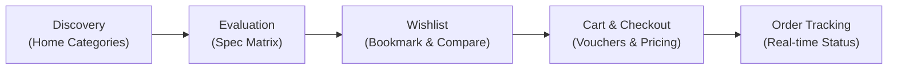
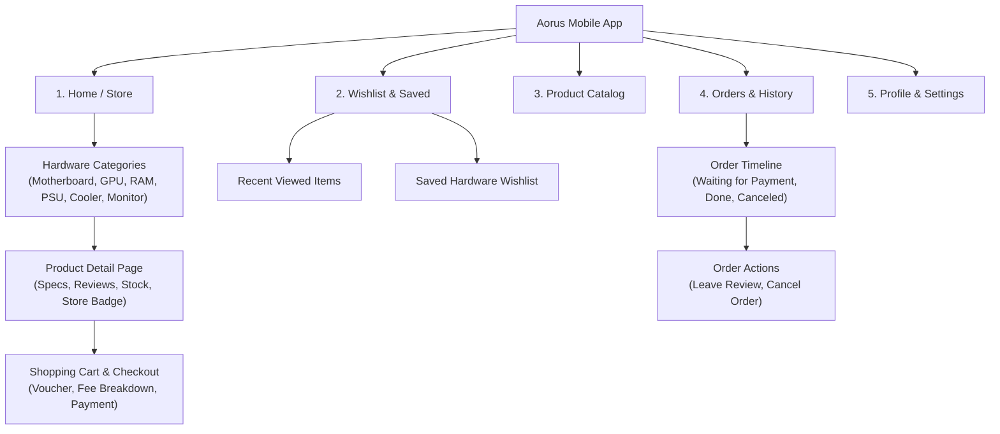
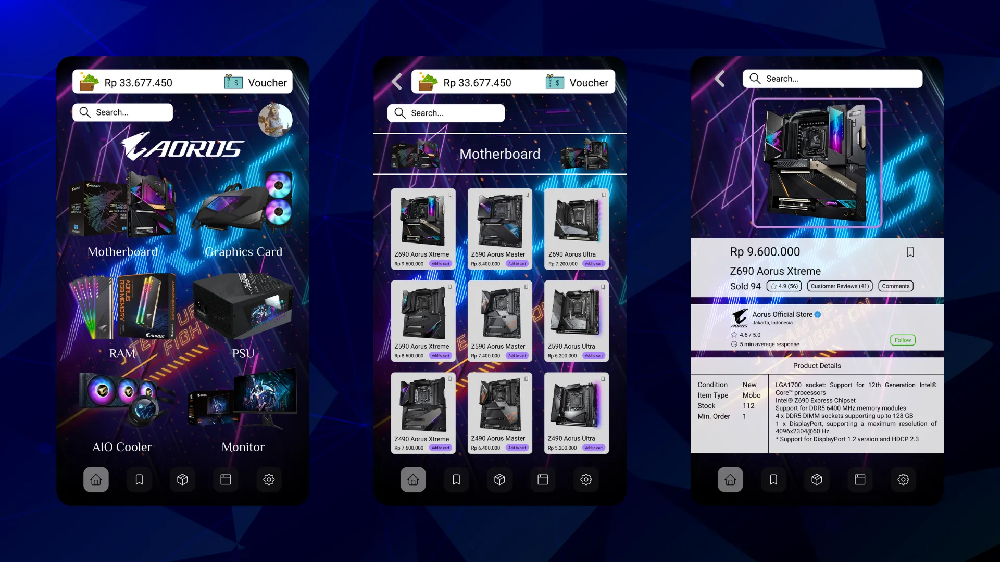

# Aorus Gaming Shop Mobile App UI/UX Design


-green)


## Project Overview

Aorus Gaming Shop Mobile App is a specialized mobile e-commerce interface concept designed specifically for PC gaming enthusiasts, custom system builders, and hardware power users. The application delivers an immersive, brand-aligned shopping experience that simplifies the discovery, specification evaluation, and purchase of premium gaming components—ranging from flagship motherboards and graphics cards to liquid cooling solutions and high-refresh-rate displays. By combining a futuristic cyber-dark aesthetic with structured technical datasheets and streamlined checkout flows, the interface bridges the gap between intricate hardware parameters and effortless mobile commerce.

## Problem Statement & Objectives

Shopping for complex PC hardware on mainstream mobile e-commerce platforms often presents frustrating friction points for enthusiasts. Dense component specifications are frequently buried in unformatted plain text, compatibility parameters are ambiguous, and generic storefront layouts fail to convey the premium performance identity of high-end hardware.

- **Clarify Hardware Specifications**: Structure dense technical attributes (socket types, chipset models, memory speeds, dimensions) into standardized, scannable data matrices.
- **Elevate Brand Aesthetics**: Create an authentic dark-mode visual language reflecting the neon-cyber and RGB ethos of the Aorus gaming ecosystem.
- **Streamline Purchase Workflows**: Minimize checkout barriers through persistent wallet counters, direct coupon redemptions, and clear order timeline tracking.
- **Facilitate Component Comparison**: Provide wishlist and side-by-side spec evaluation tools directly accessible from mobile screen viewports.

## Project Type & Design Approach

This project is an end-to-end mobile user interface and user experience design that employs User-Centered Design (UCD) principles tailored to the high-involvement domain of computer hardware procurement.

| Attribute | Description |
|---|---|
| **Project Type** | Mobile E-Commerce Application Design |
| **Supporting Discipline** | Visual UI Design & Design System Architecture |
| **Design Approach** | User-Centered Design (UCD) & Spec-First Information Architecture |
| **Target Platform** | Mobile (iOS & Android) |
| **Primary Tool** | Figma |
| **Main Deliverable** | High-Fidelity UI Screens & Interactive Mockups |

## Target Audience & User Needs

The platform is designed for individuals with varying degrees of hardware expertise who demand accuracy and efficiency during mobile component transactions:

- **PC Gamers & Modders**: Require quick visual confirmation of form factors, RGB aesthetics, and flagship cooling capabilities.
- **Custom System Builders**: Need immediate verification of socket compatibility (e.g., LGA1700), chipset generations (Z690/Z590), and DDR5 memory headroom.
- **Esports Competitors & Streamers**: Seek ultra-high refresh rate displays, high-wattage power delivery units, and silent liquid cooling solutions.
- **Hardware Collectors & Upgraders**: Demand real-time stock notifications, wishlist price tracking, and order fulfillment transparency.

## User Personas & Journey Mapping

To anchor interface decisions around real behavioral patterns, target user archetypes and end-to-end purchasing pathways were mapped:

| Persona | Role / Segment | Core Goals | Key Frustrations | Design Intervention |
|---|---|---|---|---|
| **Alex Pratama** (24) | Competitive Gamer & Builder | Secure flagship GPU/motherboard at official MSRP with verified specs | Incomplete spec tables, uncertainty regarding DDR5 compatibility | Dedicated structured specification cards and official store verification |
| **Reza Wijaya** (29) | Tech Enthusiast & Content Creator | Track order status and manage multiple build wishlists | Fragmented cart breakdowns and unclear shipping tracking | Grouped wishlist comparison chips and color-coded status badges |



## Design Scope & Deliverables

The design scope encompasses core user journeys across the mobile shopping lifecycle, from initial hardware discovery through checkout and fulfillment verification.

| Deliverable | Description | Status / Location |
|---|---|---|
| **Discovery & Home Hub** | Category navigation tiles, wallet balance, search bar, and hero branding | Completed (`screenshot/image1.webp`) |
| **Catalog & Product Grid** | Filterable hardware listings with thumbnail previews, pricing, and fast add-to-cart | Completed (`screenshot/image1.webp`) |
| **Product Detail Page (PDP)** | Interactive product showcase, rating breakdown, merchant badge, and spec sheet | Completed (`screenshot/image1.webp`) |
| **Wishlist & Comparison View** | Dual-tab view (`Recent` vs `Wishlist`) with specification highlights and actions | Completed (`screenshot/image2.webp`) |
| **Shopping Cart & Checkout** | Itemized bill, voucher application indicator, fee breakdown, and primary checkout CTA | Completed (`screenshot/image2.webp`) |
| **Order History Tracker** | Chronological transaction feed with filter pills and color-coded order states | Completed (`screenshot/image2.webp`) |

## Information Architecture & Sitemap

The application architecture organizes extensive hardware catalogs into an accessible 5-tab bottom navigation structure, prioritizing high-frequency actions within thumb-zone accessibility.



## Design System & Component Library

A cohesive component ecosystem was constructed to ensure visual uniformity across disparate hardware categories and interface densities.

| Component / Style | Purpose & Specifications | Reference |
|---|---|---|
| **Cyber-Neon Color Tokens** | Deep dark canvas (`#0A0E17`) with Aorus Orange (`#FF5500`) and Neon Cyan (`#00D2FF`) accents | Visual UI Foundation |
| **Hardware Spec Cards** | Two-column structured key-value table for technical attributes (socket, chipset, RAM) | Product Detail View |
| **Category Nav Tiles** | Framed image containers with high-contrast typography and glow hover states | Home Screen Hub |
| **Status Tag Badges** | Rounded contextual pills: Warning Yellow (Pending), Emerald Green (Done), Crimson Red (Canceled) | Order Management Feed |
| **Quantity Stepper** | Accessible inline counter controls (`- 1 +`) for cart quantity adjustments | Shopping Cart |

## Design Tokens & Asset Library

Structured design tokens maintain contrast ratios, visual hierarchy, and developer handoff consistency:

| Token Category | Token Name | Value | Purpose |
|---|---|---|---|
| **Color** | `color-bg-canvas` | `#0A0E17` | Base application background |
| **Color** | `color-bg-surface` | `#141B26` | Card and sheet elevation background |
| **Color** | `color-primary-aorus` | `#FF5500` | Brand primary accent & active states |
| **Color** | `color-accent-cyan` | `#00D2FF` | Interactive secondary buttons and indicators |
| **Color** | `color-status-success` | `#00E676` | Verified badges and completed orders |
| **Color** | `color-status-warning` | `#FFAB00` | Pending payments and shipping alerts |
| **Color** | `color-status-danger` | `#FF3366` | Canceled orders and destructive actions |
| **Typography** | `font-family-primary` | `'Inter', 'Rajdhani', sans-serif` | Clean, tech-forward geometric type scale |
| **Elevation** | `radius-card` | `12px` | Subtle curved corner styling for containers |

```css
:root {
  --color-bg-canvas: #0A0E17;
  --color-bg-surface: #141B26;
  --color-primary-aorus: #FF5500;
  --color-accent-cyan: #00D2FF;
  --color-accent-purple: #7928CA;
  --color-status-success: #00E676;
  --color-status-warning: #FFAB00;
  --color-status-danger: #FF3366;
  --radius-sm: 6px;
  --radius-md: 12px;
  --radius-lg: 20px;
}
```

## Design Solution & Key Features

The finalized user experience resolves critical hardware procurement pain points through purposeful interface interventions:

- **Spec-First Product Detail Page**: Standardizes hardware parameters into clear tabular matrices, allowing builders to confirm motherboard socket compatibility, chipset types, and DDR5 frequency limits at a glance.
- **Streamlined Hardware Taxonomy**: Employs graphical category tiles on the home screen to let users instantly filter between Motherboards, Graphics Cards, RAM, PSUs, AIO Coolers, and Monitors.
- **Dedicated Hardware Wishlist**: Enables gamers to save prospective components, compare pricing fluctuations, and batch-add parts directly into the shopping cart.
- **Transparent Cart Breakdown**: Eliminates hidden checkout surprises by detailing item subtotals, zero-cost shipping vouchers, and transparent platform administration fees.
- **Context-Aware Order Timeline**: Provides chronological order tracking with color-coded tags indicating real-time fulfillment states (`Waiting for payment`, `Done`, `Canceled`).

## Design Workflow

The interface was developed through an iterative design lifecycle focused on component modularity and responsive usability:

1. **Requirements & Domain Analysis**: Audited enthusiast PC building workflows, hardware classification standards, and mobile e-commerce conversion patterns.
2. **Information Architecture & Wireframing**: Formulated the 5-tab navigation model and established wireframe layouts for spec-heavy product cards.
3. **Design System & Visual Language**: Crafted dark-mode color tokens, typography scales, neon cyber accents, and component states in Figma.
4. **High-Fidelity Mockup Production**: Built pixel-perfect screen compositions incorporating official Aorus product assets and realistic hardware data.
5. **Usability Review & Visual Refinement**: Adjusted button touch targets, optimized contrast ratios across dark backgrounds, and streamlined checkout step indicators.

## Design Tools & Tech Stack

| Category | Tool / Technology | Purpose |
|---|---|---|
| **UI/UX Design Application** | Figma | Component architecture, responsive layouts, and screen mockups |
| **Brainstorming & Flow Mapping** | FigJam | User flow visualization and sitemap information architecture |
| **Asset Editing & Optimization** | Adobe Photoshop | Hardware asset masking, background texture generation, and image post-processing |
| **Vector Graphics & Icons** | Adobe Illustrator | Vector iconography and brand badge rendering |
| **Asset Delivery Format** | WebP | High-efficiency lossless screen compression for web documentation |

## Design Preview

### 1. Main Navigation, Catalog Grid & Hardware Specification Details

The primary discovery interface combines an atmospheric neon-cyber home hub featuring quick-access hardware categories with a filterable motherboard catalog grid and an in-depth product detail page. The detail view organizes essential hardware criteria—including socket format, chipset generation, DDR5 memory frequency, and official store verification—into a scannable technical datasheet.

### 2. Wishlist Management, Shopping Cart & Order Tracking Interface

The fulfillment experience features dual-tab wishlist and recent item management for side-by-side component evaluation, a transparent shopping cart breakdown with coupon deductions and platform fees, and a chronological order history dashboard equipped with color-coded status pills and quick-action review buttons.

## Contributing

Contributions, feedback, and design improvements are welcome:

1. Fork the repository.
2. Create a branch for your proposed design enhancements (`git checkout -b feature/design-improvement`).
3. Make your changes and ensure visual assets conform to standard resolutions and naming rules.
4. Check that relevant design files, assets, and documentation are organized correctly in `screenshot/`.
5. Commit and push your branch (`git commit -m "feat: enhance mobile checkout flow"`).
6. Open a pull request with a clear explanation of your design decisions and attach relevant WebP previews.

## License

This project is licensed under the MIT License.
See the [LICENSE](LICENSE) file for details.

## Author & Contact

**Yohanes Dimas Pratama**

- GitHub: [github.com/weztcy](https://github.com/weztcy)
- Portfolio: [yohanesdimas.com](https://yohanesdimas.com)
- LinkedIn: [linkedin.com/in/yohanes-dimas](https://www.linkedin.com/in/yohanes-dimas)
