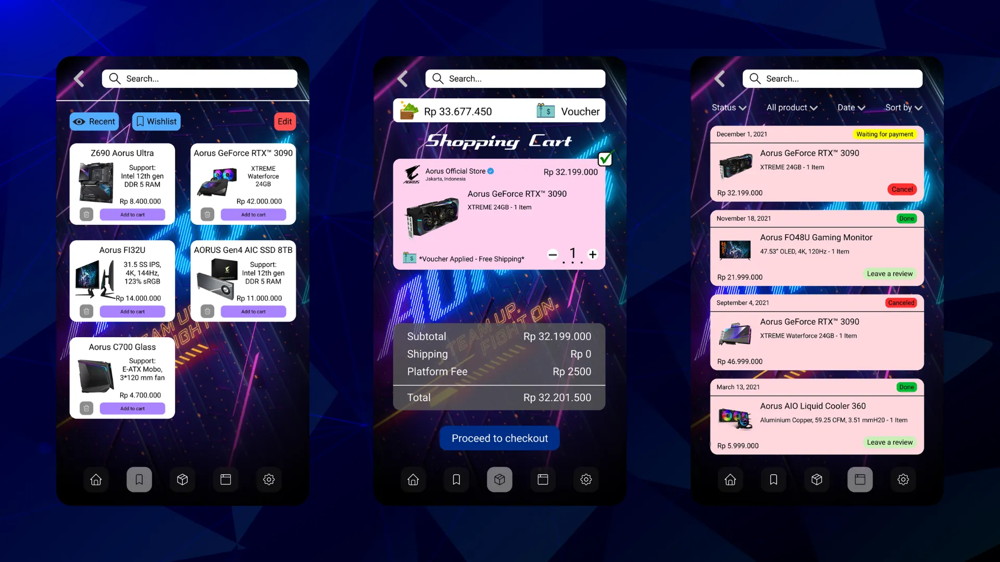

# Aorus Gaming Shop Mobile App UI/UX Design

-green)

## Project Overview

Aorus Gaming Shop Mobile App is a dedicated mobile commerce user interface and user experience design concept tailored specifically for PC gaming enthusiasts and custom computer builders. The project centers on the premium Aorus hardware ecosystem by Gigabyte, establishing a seamless digital retail environment where users can explore high-performance PC components, inspect intricate hardware specifications, manage wishlists, and complete transparent checkout transactions within an immersive dark cyberpunk aesthetic.

## Problem Statement & Objectives

PC builders and gaming enthusiasts often struggle with standard e-commerce mobile applications that treat technical hardware like generic retail commodities. Standard mobile apps frequently bury critical hardware compatibility details, obscure socket and memory generations, clutter interfaces with irrelevant recommendations, and introduce friction into multi-item purchase workflows.

- Establish an intuitive visual hierarchy that presents complex PC hardware specifications (such as LGA sockets, DDR5 frequencies, and PCIe generations) clearly on compact mobile displays.
- Design an engaging, branded shopping environment reflecting the futuristic, high-performance identity of the Aorus gaming ecosystem.
- Streamline the end-to-end buying journey from component discovery and category filtering to cart configuration, discount voucher application, and post-purchase tracking.
- Provide accessible micro-interactions and explicit transaction statuses that build buyer confidence when purchasing high-value computer hardware.

## Project Type & Design Approach

The project is structured around an end-to-end mobile user experience and user interface design approach, employing user-centered design methodologies to align technical data density with fluid mobile ergonomics.

| Attribute | Description |
| --- | --- |
| Project Type | Mobile App Design |
| Supporting Discipline | Visual UI Design & Interaction Design |
| Design Approach | User-Centered Design (UCD) with Atomic Component Architecture |
| Target Platform | Mobile (Android & iOS) |
| Primary Tool | Figma |
| Main Deliverable | High-Fidelity UI Screens & Component Mockups |

## Target Audience & User Needs

The design addresses two primary consumer groups within the gaming and personal computing industry: passionate PC gaming enthusiasts seeking flagship hardware upgrades, and independent PC builders requiring granular technical compatibility validation.

- Need for rapid access to categorized hardware families including Motherboards, Graphics Cards, High-Speed RAM, Power Supplies, AIO Liquid Coolers, and Gaming Displays.
- Requirement for transparent technical parameter tables detailing CPU socket architecture, memory bus speeds, form factors, and display interface standards.
- Expectation of upfront cost transparency with real-time subtotal breakdowns, voucher discounts, and explicit delivery fee calculations.
- Demand for a unified transaction management interface tracking orders across pending payment, fulfillment, and post-delivery review stages.

## Design Scope & Deliverables

The scope of work encompasses the foundational user journeys of a specialized hardware storefront, delivered as high-fidelity vector mockups and structured interface components.

| Deliverable | Description | Status / Location |
| --- | --- | --- |
| High-Fidelity Home Screen | Category hub featuring wallet balance, voucher access, search bar, and 2x3 hardware category grid | Completed / [screenshot/banner.webp](screenshot/banner.webp) |
| Category Catalog Grid | Subcategory hardware listing displaying motherboard series, pricing in IDR, and direct add-to-cart triggers | Completed / [screenshot/image1.webp](screenshot/image1.webp) |
| Technical Product Details | Deep hardware specification sheet detailing LGA1700 socket, DDR5 6400 MHz support, stock levels, and verified store profile | Completed / [screenshot/image1.webp](screenshot/image1.webp) |
| Saved Items & Wishlist | Curated hardware collection view with spec summaries, edit capabilities, and direct cart migration | Completed / [screenshot/image2.webp](screenshot/image2.webp) |
| Cart & Pre-Checkout Sheet | Shopping cart summary with store verification, quantity stepper, free-shipping voucher application, and total order breakdown | Completed / [screenshot/image2.webp](screenshot/image2.webp) |
| Order History Dashboard | Filterable transaction log tracking multi-state order progress including Waiting for Payment, Done, and Canceled | Completed / [screenshot/image2.webp](screenshot/image2.webp) |

## Design Solution & Key Features

The design solution resolves technical clutter by implementing a dark obsidian aesthetic illuminated by neon cyan, electric violet, and Aorus brand amber accents. This palette elevates product imagery while maintaining legibility and functional clarity across all e-commerce touchpoints.

- **Branded Discovery Hub**: Integrates instant wallet balance metrics, voucher redemption shortcuts, and visual hardware category cards (Motherboards, GPUs, RAM, PSUs, Coolers, Monitors) for rapid top-level navigation.
- **Granular Hardware Specification Tables**: Presents mission-critical motherboard architecture details (socket type, chipset, memory DIMM sockets, maximum frequencies, and display outputs) in an organized, scannable key-value format.
- **Verified Official Store Profile**: Embeds authenticated store credibility indicators, response times, location badges, and customer ratings directly above specifications to assure authenticity for high-ticket items.
- **Dynamic Shopping Cart Breakdown**: Automates order calculation with visual voucher tags, transparent platform fees, free shipping exemptions, and prominent single-tap checkout CTAs.
- **Multi-State Transaction History**: Organizes past and active orders chronologically with color-coded status badges (`Waiting for payment`, `Done`, `Canceled`) and contextual post-purchase actions such as leaving reviews or canceling pending orders.

## Design Workflow

The project followed an iterative design process prioritizing technical readability and mobile e-commerce ergonomics:

1. **Hardware Domain & Competitive Analysis**: Examined existing gaming hardware retail platforms and desktop catalog configurations to identify mobile layout deficiencies and missing technical metadata.
2. **Information Architecture & Journey Mapping**: Structured the five primary application modules (Home Discovery, Wishlist Catalog, Shopping Cart, Order Records, and Account Settings) around a persistent bottom navigation bar.
3. **Design System & Component Styling**: Established design tokens consisting of dark background foundations (`#0B0E14`), luminous neon accents, standard 8pt spacing intervals, and reusable component cards.
4. **High-Fidelity Screen Synthesis**: Crafted pixel-perfect mobile artboards in Figma, balancing high-contrast product renders against structured data layouts and interactive CTA buttons.
5. **Asset Optimization & Export**: Rendered high-resolution interface presentations and converted display assets into high-performance WebP formats for documentation and showcase integration.

## Design Tools & Tech Stack

| Category | Tool / Technology | Purpose |
| --- | --- | --- |
| Primary Design Software | Figma | Wireframing, high-fidelity UI mockup creation, and component architecture |
| Brainstorming & User Flow | FigJam | User journey mapping and information architecture planning |
| Vector Graphics & Assets | Adobe Illustrator | Brand iconography, custom vector assets, and typography preparation |
| Documentation Asset Format | WebP | High-efficiency lossless and lossy visual documentation rendering |

## Design Preview

The visual design system utilizes a dark-mode foundation to accentuate RGB-lit PC hardware renders and high-contrast typography, ensuring an engaging browsing experience across all screens.

*Hardware Category Catalog and Comprehensive Technical Product Detail Views*

*Saved Hardware Wishlist, Dynamic Shopping Cart Summary, and Chronological Transaction Tracking Views*

## Contributing

Contributions to this design project repository are welcome. To propose design improvements or submit assets:

1. Fork the repository.
2. Create a branch for the change (`git checkout -b feature/design-enhancement`).
3. Make the changes.
4. Check that relevant design files, assets, and documentation are organized correctly.
5. Commit and push the branch (`git commit -m "Add design enhancement"`).
6. Open a pull request with a clear explanation and relevant previews when applicable.

## License

This project is licensed under the MIT License.
See the [LICENSE](LICENSE) file for details.

## Author & Contact

**Yohanes Dimas Pratama**

- GitHub: [github.com/weztcy](https://github.com/weztcy)
- Portfolio: [yohanesdimas.com](https://yohanesdimas.com)
- LinkedIn: [linkedin.com/in/yohanes-dimas](https://www.linkedin.com/in/yohanes-dimas)
