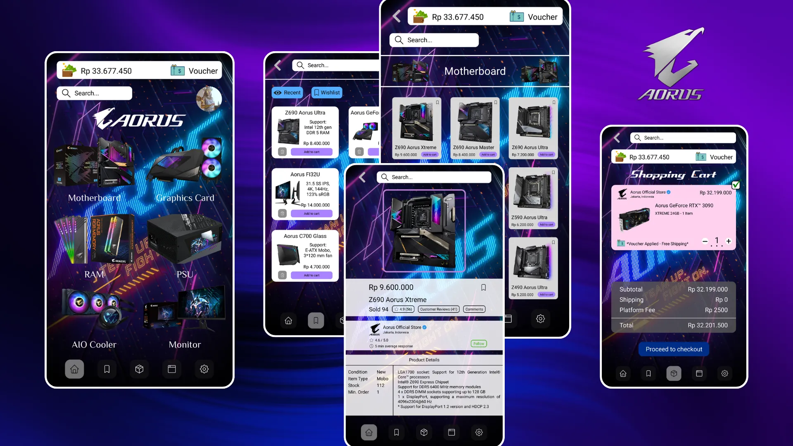
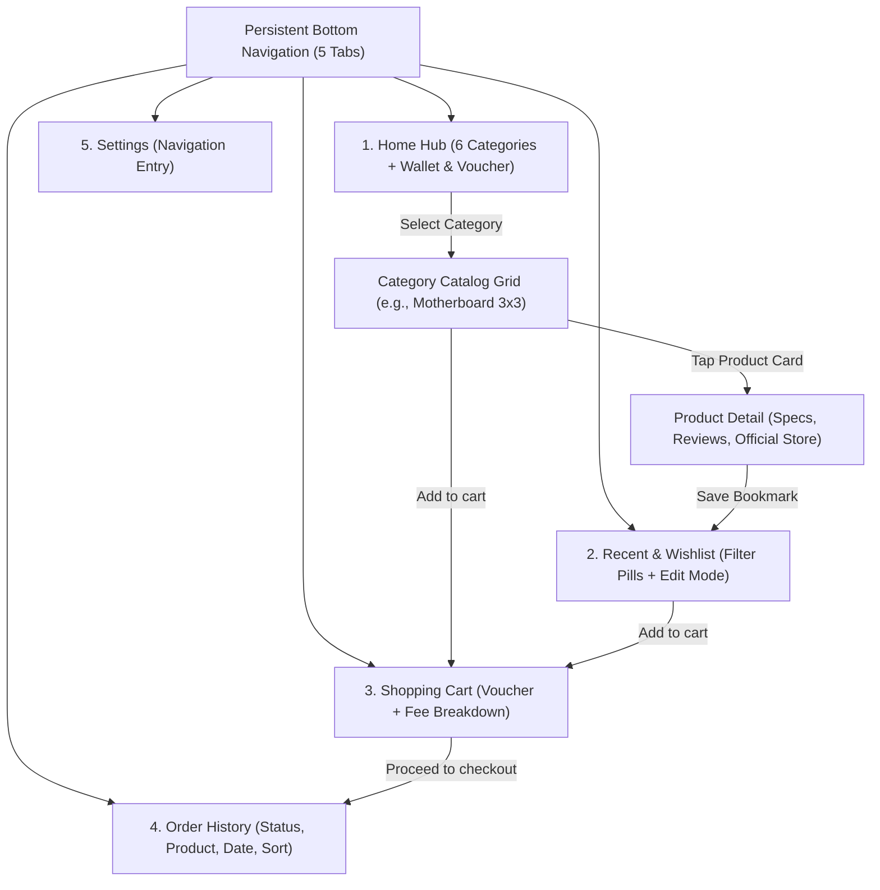
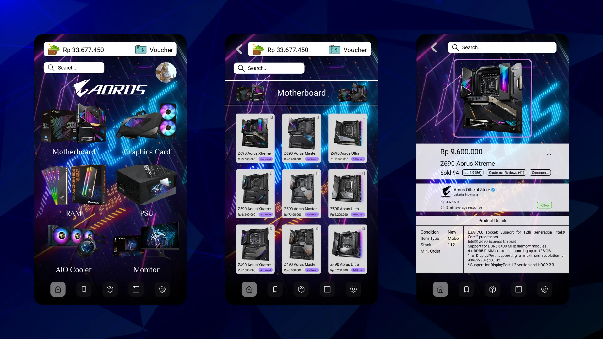
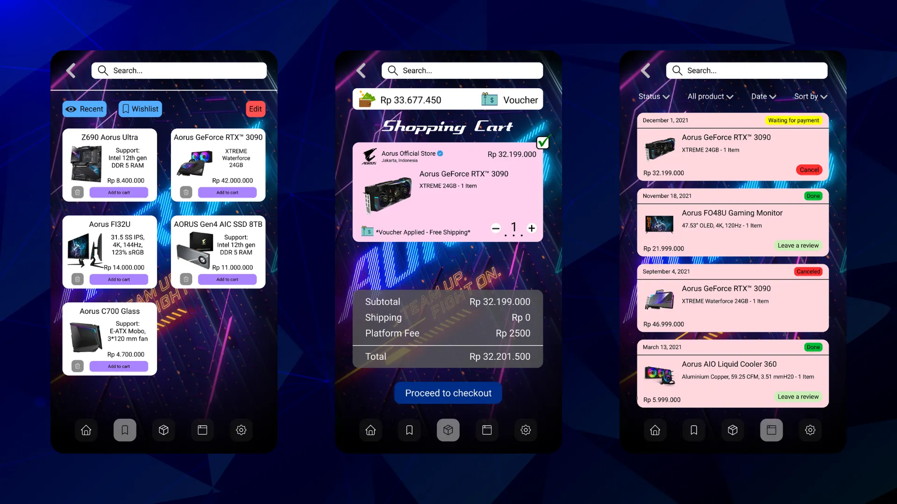

# Aorus Gaming Shop Mobile App UIUX Design

## Project Overview

**Aorus Gaming Shop Mobile App UIUX Design** is a conceptual mobile e-commerce UI/UX design project tailored for PC gaming hardware and component shopping. The design focuses on delivering an AORUS-branded mobile storefront experience covering category discovery, multi-series hardware catalog browsing, detailed technical specifications, wishlist and recent-item management, shopping cart checkout summaries, and order status tracking. All deliverables in this repository are preserved as high-fidelity exported screen showcases in WebP format.

## Problem Statement & Objectives

Shopping for PC components on mobile devices often forces buyers to navigate cluttered, general-purpose marketplace layouts where critical hardware specifications—such as socket compatibility, chipset generation, DDR5 memory support, and display refresh rates—are buried beneath generic product listings. This design concept explores a dedicated mobile storefront tailored to high-value gaming hardware buyers.

- **Structured Hardware Discovery**: Organize flagship PC components into a visual six-category home hub (`Motherboard`, `Graphics Card`, `RAM`, `PSU`, `AIO Cooler`, `Monitor`) paired with persistent search access.
- **Fast Model Tier Comparison**: Present multi-generation product series (such as `Z690`, `Z590`, and `Z490` motherboards) in a clean grid with upfront pricing and direct `Add to cart` actions.
- **Specification & Store Clarity**: Surface key technical specs, stock availability, verified official store ratings, and response times directly on the product detail view.
- **Transparent Purchasing & Tracking**: Integrate wallet balance and voucher visibility into the header and provide clear status-coded order tracking (`Waiting for payment`, `Done`, `Canceled`).

## Project Type & Design Approach

This repository is a static visual design archive centered on **Mobile App Design** and **UI/UX Design**. The visual language blends an AORUS-themed dark neon gaming backdrop (`#000036` and `#18B0E8` accents) with high-contrast white (`#FFFFFF`) and soft pink (`#FFD1EE`, `#FFD8DE`) content cards to preserve product readability and pricing clarity. Because no separate UX research report or clickable prototype source file is stored in the repository, the design approach is documented directly from the exported high-fidelity screen artifacts.

| Attribute | Description |
| :--- | :--- |
| **Project Type** | Mobile App Design |
| **Supporting Discipline** | UI Design, E-Commerce Experience Design |
| **Design Approach** | User-Centered Visual Hierarchy & Task-Oriented Flows |
| **Target Platform** | Mobile (iOS & Android) |
| **Primary Tool** | Figma (Inferred Standard UI Design Tool; WebP Exports Archived) |
| **Main Deliverable** | High-Fidelity Mobile UI Screen Showcases |

## Target Audience & User Needs

The interface is designed for PC gaming enthusiasts, custom rig builders, and hardware upgraders in the Indonesian market (reflected by Indonesian Rupiah `Rp` pricing and `Jakarta, Indonesia` official store metadata). Because no formal user interview or survey dataset is included in this repository, the user needs below reflect intended design goals inferred from the interface structure rather than validated research metrics.

- **PC Hardware Builders & Upgraders**: Need rapid access to compatibility-critical specifications such as CPU socket type (`LGA1700`), chipset family, memory capacity (`DDR5`), and power or cooling metrics without leaving the product page.
- **Deal-Conscious Enthusiasts**: Need immediate visibility into wallet funds (`Rp 33.677.450` demo balance), voucher eligibility (`Free Shipping`), and itemized fee breakdowns (`Subtotal`, `Shipping`, `Platform Fee`, `Total`).
- **Repeat Storefront Buyers**: Need quick ways to revisit recently viewed hardware, manage saved wishlist items, leave reviews on completed purchases, or cancel pending orders.

## Design Scope & Deliverables

The repository preserves the finalized high-fidelity visual showcase exports in [`screenshots/`](screenshots/) alongside project licensing metadata in [`LICENSE`](LICENSE). Six distinct mobile application screens are presented across two multi-screen preview collages plus a hero presentation banner.

| Deliverable | Description | Status / Location |
| :--- | :--- | :--- |
| **Hero Showcase Banner** | Multi-screen presentation collage featuring AORUS branding and core app flows | Completed ([`screenshots/banner.webp`](screenshots/banner.webp)) |
| **Discovery & Product Screens** | 3-screen showcase covering Home, Motherboard Catalog, and Product Detail | Completed ([`screenshots/image1.webp`](screenshots/image1.webp)) |
| **Retention & Checkout Screens** | 3-screen showcase covering Recent/Wishlist, Shopping Cart, and Order History | Completed ([`screenshots/image2.webp`](screenshots/image2.webp)) |
| **Repository License** | MIT open-source licensing terms | Completed ([`LICENSE`](LICENSE)) |

## Information Architecture & Sitemap

The mobile application organizes core shopping tasks around a persistent five-tab bottom navigation bar (`Home`, `Wishlist`, `Shopping Cart`, `Order History`, and `Settings`), complemented by a global top `Search...` input and quick-access `Wallet` and `Voucher` indicators on key discovery and checkout views.

## Design Solution & Key Features

The design resolves the tension between vibrant gaming brand aesthetics and dense technical e-commerce data by isolating dark neon geometric backgrounds to the outer chrome while placing product cards, pricing, and specifications on clean light surfaces.

- **Persistent Wallet & Voucher Bar**: Displays current wallet balance alongside a one-tap `Voucher` shortcut on Home, Catalog, and Shopping Cart screens for immediate promotional context.
- **Category-First Home Grid**: Showcases six core PC component categories with isolated hardware renders over a dark AORUS backdrop, reducing cognitive load upon launch.
- **Multi-Tier Catalog Cards**: Organizes related chipset tiers (`Z690`, `Z590`, `Z490`) across `Xtreme`, `Master`, and `Ultra` trims in a scannable 3-column grid with bookmark toggles and `Add to cart` buttons.
- **Specification-Rich Product Detail**: Combines a framed product gallery, unit sales counter (`Sold 94`), rating pills (`4.9 (56)`), `Aorus Official Store` verification card (`4.6 / 5.0`, `5 min average response`, `Follow`), and structured `Product Details` metadata (`Condition`, `Item Type`, `Stock`, `Min. Order`, and chipset specs).
- **Recent & Wishlist Curation**: Provides `Recent` and `Wishlist` filter pills alongside an `Edit` mode, per-item trash actions, key spec summaries, and direct `Add to cart` buttons.
- **Transparent Cart & Order Status System**: Highlights applied shipping vouchers (`*Voucher Applied - Free Shipping*`), quantity steppers, itemized fee calculations, and color-coded order badges (`Waiting for payment`, `Done`, `Canceled`) with contextual `Cancel` and `Leave a review` actions.

## Design Workflow

Based on the visual artifacts archived in [`screenshots/`](screenshots/), the design execution followed a focused high-fidelity UI workflow:

1. **Brand & Aesthetic Direction**: Established an AORUS gaming visual identity pairing deep midnight blue (`#000036`) and neon cyan (`#18B0E8`) backdrops with high-contrast card surfaces (`#FFFFFF`, `#FFD1EE`, `#FFD8DE`).
2. **Core E-Commerce Screen Architecture**: Defined the end-to-end mobile shopping journey across six primary screens—Home, Category Catalog, Product Detail, Recent & Wishlist, Shopping Cart, and Order History—anchored by a five-icon bottom navigation bar.
3. **High-Fidelity Screen & Component Design**: Crafted reusable UI components including the top search bar, wallet/voucher strip, product grid cards, official store badge card, quantity stepper, and semantic order status pills.
4. **Showcase Packaging & WebP Export**: Assembled the six mobile screens into two structured three-up presentation boards ([`screenshots/image1.webp`](screenshots/image1.webp), [`screenshots/image2.webp`](screenshots/image2.webp)) and a composite hero banner ([`screenshots/banner.webp`](screenshots/banner.webp)).

## Design Tools & Tech Stack

Only design tools and asset formats evidenced or directly applicable to the archived visual deliverables are listed below.

| Category | Tool / Technology | Purpose |
| :--- | :--- | :--- |
| **UI/UX Design** | Figma (Inferred) | High-fidelity mobile screen layout, component styling, and visual composition |
| **Asset Export Format** | WebP | Lightweight, high-resolution screen showcase and banner image exports |
| **Documentation** | Markdown & Mermaid | Structured repository documentation and information architecture diagramming |

## Design Preview

### 1. Home Discovery, Motherboard Catalog & Product Detail Interface

This three-screen progression illustrates the core browsing funnel from category selection to technical product evaluation. The Home screen pairs a top wallet/voucher bar and search input with six hardware category tiles, transitioning into a 3-column `Motherboard` catalog grid (`Z690`, `Z590`, `Z490` series) with direct `Add to cart` buttons, and concluding at the `Z690 Aorus Xtreme` detail screen featuring seller trust metrics and structured chipset specifications.

### 2. Wishlist Management, Shopping Cart & Order Tracking Interface

This showcase highlights post-browsing retention, checkout clarity, and order lifecycle visibility across three screens. Users can toggle between `Recent` and `Wishlist` items with quick spec snippets and trash/cart actions, review voucher-applied pricing (`Subtotal`, `Shipping`, `Platform Fee`, `Total`) inside the Shopping Cart, and filter transactions in Order History using semantic status pills (`Waiting for payment`, `Done`, `Canceled`) and contextual `Cancel` or `Leave a review` buttons.

## Contributing

Contributions to refine documentation, organize assets, or extend the design screens are welcome through a standard pull request workflow:

1. Fork the repository.
2. Create a branch for the change.
3. Make the changes.
4. Check that relevant design files, assets, and documentation are organized correctly.
5. Commit and push the branch.
6. Open a pull request with a clear explanation and relevant previews when applicable.

## License

This project is licensed under the MIT License.
See the [LICENSE](LICENSE) file for details.

## Author & Contact

**Yohanes Dimas Pratama**

- GitHub: [github.com/weztcy](https://github.com/weztcy)
- Portfolio: [yohanesdimas.com](https://yohanesdimas.com)
- LinkedIn: [linkedin.com/in/yohanes-dimas](https://www.linkedin.com/in/yohanes-dimas)
